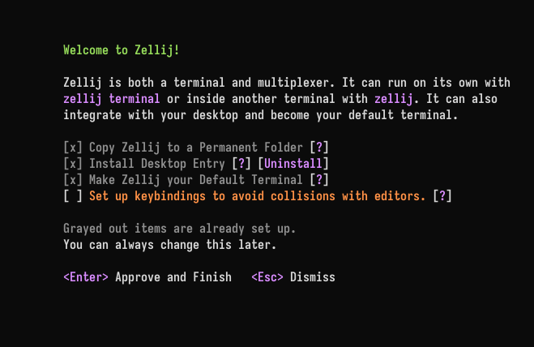

# Desktop Setup

Zellij can add itself to the desktop: a copy of Zellij in a permanent folder, a desktop entry (an app menu launcher, Zellij.app on macOS, or a Start menu shortcut on Windows), and Zellij as the default terminal. These open the [Zellij terminal](./zellij-terminal.md).

## The setup screen

The setup screen is shown when a new session starts for the first time (when Zellij had to create its configuration file). Until it is approved or dismissed with "Don't Show Again", it is offered again in new sessions while one of its items is still missing.

It can be opened at any time:

- From the [settings screen](./settings-screen.md), with `Ctrl w`
- From the About screen (`Ctrl o` + `a`), with `s` ("Setup Zellij")



The screen lists what can be set up on this computer. Items that are already set up are grayed out:

- **Copy Zellij to a Permanent Folder** - so `zellij` can be run from anywhere, and so the desktop entry and the default terminal run that copy instead of the file that was started (eg. one in the Downloads folder)
- **Install Desktop Entry** - an app menu launcher on Linux, Zellij.app on macOS, a Start menu entry and an "Open Zellij here" Explorer item on Windows
- **Make Zellij your Default Terminal** - Linux only
- **Keybindings** - choose a [keybinding preset](./keybinding-presets.md) that avoids collisions with editors and other programs

"Approve and Finish" applies the checked items and shows what was written or removed.

Desktop items are not offered when there is no desktop: over SSH, inside a container (Distrobox, Toolbox, Flatpak, Podman, Docker), in WSL, or on Linux without `DISPLAY` or `WAYLAND_DISPLAY`. Setting the environment variable `ZELLIJ_DESKTOP_INTEGRATION=on` treats the environment as a desktop anyway, and `ZELLIJ_DESKTOP_INTEGRATION=off` never offers desktop items.

## From the command line

Everything the setup screen does is also available through `zellij setup`. These flags use the same checks as the setup screen and can be combined:

| Flag | Description |
|:-----|:------------|
| `--copy-to-permanent-folder` | Copy this Zellij to a permanent folder, or update an older Zellij already there |
| `--replace-existing` | With `--copy-to-permanent-folder`: replace a different file that is in the way |
| `--install-desktop-entry` | Install the desktop entry |
| `--uninstall-desktop-entry` | Remove the desktop entry Zellij installed. Entries Zellij did not write are left alone |
| `--make-default-terminal` | Make Zellij the default terminal, installing the desktop entry if it is missing |
| `--keybinding-preset <PRESET>` | Choose a keybinding preset (eg. `unlock-first`) and save it to the configuration file |

```
$ zellij setup --install-desktop-entry
$ zellij setup --make-default-terminal
$ zellij setup --keybinding-preset unlock-first
```

When the desktop entry or the default terminal is installed from a Zellij that is not in a permanent place, Zellij copies itself to the permanent folder first and points the entry at that copy.

## Linux

- **Permanent folder**: `~/.local/bin/zellij`. No copy is offered when Zellij is already in a permanent place: a package manager's path (eg. Nix, Homebrew, `cargo install`), `/usr`, `/usr/local` or `/opt`.
- **Desktop entry**: `~/.local/share/applications/dev.zellij.Zellij.desktop`, with icons in `~/.local/share/icons/hicolor/`. It runs `zellij terminal` and has Show Inbox, Show Sessions and New Window actions. If a package manager already installed the launcher (in `$XDG_DATA_DIRS/applications`), Zellij shows it as installed by the package manager and does not write its own. An old `zellij.desktop` written by an earlier Zellij is removed.
- If the desktop entry later points at a Zellij that no longer exists, a new session offers to repair it.

### Default terminal

Zellij can become the default terminal on KDE Plasma, Cinnamon and MATE, and on desktops that use [xdg-terminal-exec](https://github.com/Vladimir-csp/xdg-terminal-exec). It needs the desktop entry. Zellij never changes the default terminal back by itself.

Elsewhere, the setup screen explains how to do it by hand:

- On tiling window managers, bind `zellij terminal` to the key used to open a terminal
- On Debian and Ubuntu, `sudo update-alternatives --config x-terminal-emulator` chooses the default terminal
- Installing xdg-terminal-exec lets Zellij set it

Other apps then run `zellij terminal -e <command>` or `zellij terminal --working-directory=<dir>`. Where such a command opens is set with [`terminal_requests`](./terminal-options.md#terminal_requests).

### Packaging

Each release has a `zellij-desktop-files.tar.gz` holding the desktop entry, icons and software-centre listing for packagers. See [PACKAGING_DESKTOP.md](https://github.com/zellij-org/zellij/blob/main/docs/PACKAGING_DESKTOP.md).

## macOS

- **Desktop entry**: `~/Applications/Zellij.app`. The app contains a signed copy of Zellij (signed with `/usr/bin/codesign`), so that its menu bar icon and desktop notifications work. It needs macOS 11.0 or later. To update Zellij.app after upgrading Zellij, install it again (eg. with `zellij setup --install-desktop-entry` from a terminal).
- **Permanent folder**: `~/.local/bin/zellij`. Zellij.app has its own copy, but running `zellij` from a terminal still needs one on the `PATH`.
- Making Zellij the default terminal is not available on macOS.

## Windows

- **Permanent folder**: `%LOCALAPPDATA%\Zellij\zellij.exe`. Zellij adds that folder to the end of the user's `PATH`, and removes it again only when it removes the copy. No copy is offered when Zellij was installed by the MSI installer, Scoop, winget, Chocolatey or cargo, or is in Program Files.
- **Start menu entry**: a Zellij shortcut in the Start menu.
- **"Open Zellij here"**: an Explorer item when right-clicking a folder, the background of a folder, or a drive.
- Making Zellij the default terminal is not offered. "Open Zellij here" is the closest equivalent.

The MSI installer can add the Start menu shortcut (a checkbox on its welcome screen, on by default) and the "Open Zellij here" item itself.
