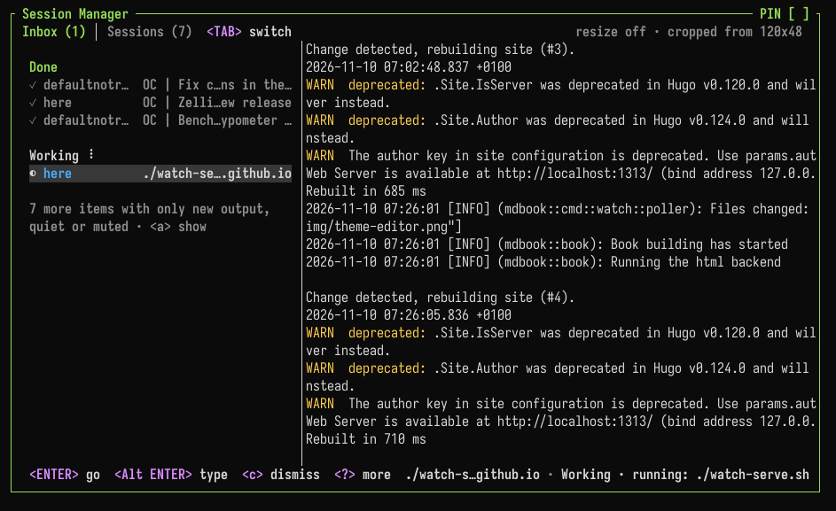

# Inbox & Attention

Zellij keeps track of what each pane needs: a program waiting for approval, a command that failed, a long build that finished. These are collected in the **inbox**, across every running session on the machine.



Many programs report to the inbox with no setup. See [Integrations](./inbox-integrations.md) for which ones, and how to connect others.

## States

Each pane has one of these states:

| State | Meaning |
|:------|:--------|
| Needs you | The program is waiting for you: approval, a question, a login, a notification or a bell |
| Failed | A command failed |
| Done | A command that ran for a while finished |
| Working | A program or a long command is running |
| Gone quiet | Busy output stopped |
| New output | Output arrived while you were looking elsewhere |

The state is shown:

- As a marker in the pane's frame title ([`frame_markers`](#frame_markers))
- As a symbol next to the tab's name in the tab bar ([`tab_markers`](#tab_markers))
- In the session indicator on the top-right of the screen, eg. `◉ 2 need you · 1 running`, counting every session
- In the inbox
- In the [Zellij terminal](./zellij-terminal.md): in the tray icon's badge ([`tray_badge`](#tray_badge)) and as desktop notifications ([`desktop_notifications`](#desktop_notifications))
- In the outer terminal, when Zellij runs inside a terminal that supports [OSC 7501](./inbox-integrations.md#passing-status-to-your-terminal) ([`host_status`](#host_status))

## Opening the inbox

- `Ctrl o` + `i` (Session mode `i`, the `ToggleSessionCard` action). In the Unlock-First preset: `Ctrl g` + `o` + `i`
- Clicking the session indicator on the top-right of the screen
- Clicking the tray icon of the Zellij terminal, or running `zellij terminal --inbox`

When a new session starts and something needs you, a small version of the inbox (the session card) is shown. This is set with [`startup_card`](#startup_card).

The inbox is part of the [session manager](./session-manager-alias.md). `Tab` switches between the inbox and the session list.

### Keys

| Key | Action |
|:----|:-------|
| `↓` `↑` | Select an item |
| `Enter` | Go to the pane, switching session if needed |
| `n` | Watch the pane |
| `m` | Mute or unmute the pane |
| `c` | Mark the item as seen |
| `C` | Dismiss everything |
| `Tab` | Switch to the session list |
| `?` | Show all keys |
| `Esc` | Close |

The inbox shows a live view of the selected pane. Clicking the view types into that pane without leaving the inbox. `Alt Enter`, the inbox key or a click outside the view gives the keys back to the inbox. An extra key for this can be set with the [`live_view_release_key`](./options.md#live_view_release_key) option.

## Where states come from

Zellij picks states up from:

- [OSC 7501](#osc-7501) program status, sent by programs that report their own state
- Desktop notifications sent by programs (OSC 9, OSC 99 and OSC 777) and the terminal bell
- Shell prompt markers ([OSC 133 or OSC 633](./shell-integration.md)), which tell when a command at the prompt finished and with which exit code
- [Command panes](./zellij-run-and-edit.md) exiting
- The program running in the pane, when it runs longer than [`done_threshold_secs`](#done_threshold_secs) (see [`track_commands`](#track_commands))
- Busy output going quiet (see [`idle_rule`](#idle_rule), [`idle_activity_secs`](#idle_activity_secs) and [`idle_silence_secs`](#idle_silence_secs))
- Output arriving in a pane that is not being looked at

Full-screen programs (such as `vim`, `less` and `htop`) and commands being typed into are not reported as working or done.

## OSC 7501

Programs and scripts can report their own state with the OSC 7501 escape sequence:

```
ESC ] 7501 ; key=value:key=value ESC \
```

The sequence can also end with BEL instead of `ESC \`.

| Key | Values |
|:----|:-------|
| `state` | `idle`, `working`, `done`, `blocked`, `error`, or `clear` to remove the status |
| `kind` | With `blocked`: `permission`, `question` or `auth` |
| `progress` | With `working` or `blocked`: a percentage from 0 to 100 |
| `msg` | Base64-encoded text, up to 2048 bytes once decoded |
| `title` | Base64-encoded label, up to 192 bytes once decoded |
| `app` | A short program name, up to 32 characters |
| `id` | Reports several tasks at once, eg. `deploy/eu-west`. Up to 8 parts separated by `/` |

Sending `ESC ] 7501 ; ? ESC \` asks Zellij what it supports. It replies with `ESC ] 7501 ; ?:states=idle,working,done,blocked,error:kinds=permission,question,auth ESC \`.

See [Integrations](./inbox-integrations.md#your-own-scripts) for a ready-made shell function.

## Watching, ignoring and muting

Each pane can be set apart from the rules above, from its right-click menu, the pane mode keys or `zellij action`:

| | Default keys | Action | What it does |
|:--|:--|:--|:--|
| **Watch pane** | `Ctrl p` + `v` | `WatchPane` | Every finished command (even a short one), the pane exiting and its output going quiet count as needing you. New output alone is not reported. Stays on until turned off |
| **Ignore output** | `Ctrl p` + `g` | `IgnorePaneOutput` | Hides only the "new output" note. Needing you, failures and finished commands are still reported |
| **Mute pane** | `Ctrl p` + `u` | `MutePane` | Hides everything the pane reports, including desktop notifications. The pane is still tracked, so unmuting shows its current state |
| **Mute tab** | `Ctrl t` + `u` | `MuteTab` | Mutes every pane in the tab |
| **Mute session** | `Ctrl o` + `u` | `MuteSession` | Mutes the whole session |

A command pane can be watched from the start:

```
$ zellij run --notify -- cargo build
$ zellij action new-pane --notify -- cargo build
```

## CLI actions

| Action | Description |
|:-------|:------------|
| `zellij action watch-pane [-p <PANE_ID>]` | Toggle watching a pane (the focused pane by default) |
| `zellij action ignore-pane-output [-p <PANE_ID>]` | Stop or start reporting new output of a pane |
| `zellij action mute-pane [-p <PANE_ID>]` | Mute or unmute a pane |
| `zellij action mute-tab [-t <TAB_ID>]` | Mute or unmute all panes in a tab (the active tab by default) |
| `zellij action mute-session` | Mute or unmute the whole session |
| `zellij action mark-pane-seen [-p <PANE_ID>]` | Mark a pane as seen, clearing past events |
| `zellij action mark-all-seen [--this-session]` | Mark every pane of every running session as seen, or only those of the current session |
| `zellij action go-to-next-attention` | Jump to the next pane that needs attention in any session, switching session if needed |
| `zellij action toggle-tray-icon` | Show or hide the Zellij terminal's tray icon until it restarts |

## Moving between sessions

Zellij remembers which sessions each client was in, so it is possible to jump back and forth:

| Default keys | Action | Description |
|:--|:--|:--|
| `Ctrl o` + `Tab` | `ToggleSession` | Switch to the session this client was in before (again to return), or to the next running session if there is none |
| `Ctrl o` + `←` | `GoToPreviousSession` | Go back in this client's session history |
| `Ctrl o` + `→` | `GoToNextSession` | Go forward in this client's session history |
| `Ctrl o` + `n` | `GoToNextAttention` | Jump to the next pane that needs attention, in any session |

The same are available as `zellij action toggle-session`, `go-to-previous-session`, `go-to-next-session` and `go-to-next-attention`. The right-click menu of the tab bar has a "Back to ..." item for `ToggleSession`.

## Configuration

Everything is configured in the `attention` block of the [configuration file](./configuration.md), or in the Attention and Notifications categories of the [settings screen](./settings-screen.md). Every key is optional. These are the defaults:

```javascript
attention {
    enabled true
    frame_markers true
    tab_markers true
    host_status true
    tray_icon true
    idle_rule "all"
    done_threshold_secs 10
    track_commands true
    idle_activity_secs 10
    idle_silence_secs 3
    startup_card "attention"
    desktop_notifications {
        needs_you true
        failed true
        done true
    }
    tray_badge {
        needs_you true
        failed true
        done true
        working true
        quiet false
        new_output false
    }
    notification_details true
}
```

### enabled
Track what panes need. When `false`, panes report nothing: no markers, inbox, session card, counts in the session indicator, tray badge or desktop notifications, and the watch and mute items leave the right-click menu. The other keys only apply when this is `true`.

### frame_markers
Show what a pane needs in its frame title.

### tab_markers
Show what a tab's panes need as a symbol in the tab bar.

### host_status
Tell the terminal Zellij runs in what the session needs, when that terminal supports it.

### tray_icon
Show the Zellij terminal's tray icon. Sessions and notifications go on when it is hidden.

### idle_rule
Notice busy output going quiet in `"all"` panes, or only in `"watched"` ones.

### done_threshold_secs
Seconds a successful command must run before it is reported as done.

### track_commands
List commands as working once they run longer than [`done_threshold_secs`](#done_threshold_secs).

### idle_activity_secs
Seconds of steady output before quiet detection applies.

### idle_silence_secs
Seconds of silence after busy output that count as gone quiet.

### startup_card
When a new session shows its session card: `"attention"` (when something needs you), `"always"` or `"never"`.

### desktop_notifications
Which items the Zellij terminal shows as desktop notifications: `needs_you`, `failed`, `done`.

### tray_badge
Which items the tray icon's badge counts: `needs_you`, `failed`, `done`, `working`, `quiet`, `new_output`. The badge shows the count of the most important type that is turned on.

### tray_badge_colors
The colour of each type as a hex colour, eg. `needs_you "#ff8c00"`. The inbox and the session list use these colours too. A type without a colour keeps the default badge colour and the theme colour in lists.

```javascript
attention {
    tray_badge_colors {
        needs_you "#ff8c00"
        failed "#e5484d"
        done "#30a46c"
        working "#3e82f7"
    }
}
```

### notification_details
Show the program and command text in desktop notifications.
