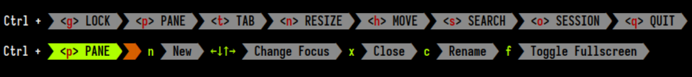
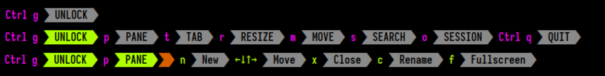

# Keybinding Presets
Keybinding Presets are a set of keybindings that can be used to control Zellij. Zellij comes with two such presets out of the box, intended to fit different kinds of users. They are described below.

A preset is a file. It holds a full set of keybindings and [mouse bindings](./mouse-bindings.md), written with placeholders for the leader keys (see [Leader keys](#leader-keys)). Besides the two built-in presets, presets can be written by hand and kept in the [keybinds folder](#the-keybinds-folder).

### The `default` preset

This preset should fit most users of Zellij. In it, all modes are accessible from the basic "normal" mode in which the user spends most of their time. One can enter `Pane` mode by pressing `Ctrl p` and then have access to all commands inside pane mode (eg. `n` to open a new pane or `x` to close the focused pane).

Its name is `default`. Its full contents can be printed with `zellij setup --dump-keybinds default`.

### The `Unlock-First (non-colliding)` preset

This preset is tailored to users who use terminal applications with keyboard shortcuts that collide with Zellij's own keybindings. In this preset, users "unlock" the interface before accessing the various input modes. The modes themselves can then be accessed with a single character shortcut.

So for example, in order to open a new pane, the user would press: `Ctrl g` followed by `p` followed by `n`. The Zellij maintainers found that after a short adjustment period, this is a fast, efficient and most importantly mentally-consistent way of interacting with the application.

Its name is `unlock-first`. Zellij starts in `locked` mode with this preset, unless the [`default_mode`](./options.md#default_mode-locked) option is set. Its full contents can be printed with `zellij setup --dump-keybinds unlock-first`.

## How to choose a preset?

### In the configuration file
The preset is chosen with the `preset` attribute of the `keybinds` block:

```javascript
keybinds preset="unlock-first" {
}
```

The value is one of:
- the name of a built-in preset (`default` or `unlock-first`)
- the name of a preset file in the [keybinds folder](#the-keybinds-folder), without the `.kdl` extension
- a path to a preset file (a relative path is taken from the folder of the configuration file)

Without a `preset` attribute, the `default` preset is used.

Bindings inside the `keybinds` block are applied on top of the preset (see [Binding and Overriding Keys](./keybindings-binding.md)). To replace the preset completely, add `clear-defaults=true` to the block.

If the preset cannot be loaded (eg. the file is missing, a leader key is empty, or the primary and secondary leader keys are the same), Zellij warns and uses the `default` preset instead.

### In the settings screen
The preset and its leader keys can also be chosen in the [settings screen](./settings-screen.md), under **Keyboard** → **Key bindings and preset…**. The settings screen is accessible with:

* `Ctrl o` + `c` in the default preset
* `Ctrl g` + `o` + `c` in the `Unlock-First` preset

The change can be applied just for the current session, or saved to the configuration file. From the same screen, a preset can be copied into the keybinds folder, and the current keybindings can be saved as a new preset there.

Choosing between the two built-in presets is also offered on the setup screen shown on the first run of Zellij.

### From the command line
To save a preset to the configuration file (creating the file if needed):

```sh
zellij setup --keybinding-preset unlock-first
```

To use a preset for a single session, without changing the configuration file:

```sh
zellij options --keybinds-preset unlock-first --keybinds-unlock "Ctrl a"
```

The flags are:
- `--keybinds-preset` - a preset name or a path to a preset file
- `--keybinds-primary` - the primary leader key (eg. `"Ctrl"`)
- `--keybinds-secondary` - the secondary leader key (eg. `"Alt"`)
- `--keybinds-unlock` - the unlock key (eg. `"Ctrl g"`)

When a preset is given with `--keybinds-preset`, a `keybinds clear-defaults=true` block in the configuration file is ignored, so that the chosen preset is used as it is. A `keybinds` block without `clear-defaults=true` is still applied on top of it.

To print a preset (built-in, or from the keybinds folder):

```sh
zellij setup --dump-keybinds default
```

## Leader keys
Presets are written with three placeholders, which are filled in with the leader keys:

| Placeholder | Meaning | Default |
|---|---|---|
| `{primary}` | The primary modifier, used to enter modes (see [Changing Modifiers](./changing-modifiers.md)) | `Ctrl` |
| `{secondary}` | The secondary modifier, used for common shortcuts | `Alt` |
| `{unlock}` | The key that leaves `locked` mode (used by `unlock-first`) | `Ctrl g` |

They are set with attributes of the `keybinds` block:

```javascript
keybinds preset="default" primary="Ctrl Alt" secondary="Alt" {
}
```

```javascript
keybinds preset="unlock-first" unlock="Ctrl a" {
}
```

The primary and secondary values must be different. The leader keys also change the [mouse bindings](./mouse-bindings.md#default-mouse-bindings) of the preset.

## The keybinds folder
Preset files are looked for in the `keybinds` folder inside the configuration folder (eg. `~/.config/zellij/keybinds/my-preset.kdl` is used with `preset="my-preset"`). A different folder can be set with the [`keybinds_dir`](./options.md#keybinds_dir) option:

```javascript
keybinds_dir "/path/to/my/keybinds_dir"
```

Preset names may contain letters, digits, `-` and `_`.

## Writing a preset
A preset file has an optional `preset` block describing it, a `keybinds` block, and an optional `mousebinds` block:

```javascript
preset {
    name "My preset"
    description "All modes available directly from the base mode, eg.:"
    example "{primary} p" "to enter PANE mode"
    example "{primary} t" "to enter TAB mode"
    default_mode "normal"
    defaults {
        primary "Ctrl"
        secondary "Alt"
    }
}
keybinds {
    locked {
        bind "{primary} g" { SwitchToMode "Normal"; }
    }
    shared_except "locked" {
        bind "{primary} g" { SwitchToMode "Locked"; }
        bind "{secondary} n" { NewPane; }
    }
}
mousebinds {
    shared {
        bind "Left" { Click; }
        bind "ScrollUp" { Scroll 3; }
        bind "ScrollDown" { Scroll 3; }
    }
}
```

- `name`, `description` and `example` (the keys, then what they do) are shown when choosing a preset.
- `default_mode` is the mode Zellij starts in with this preset, unless the [`default_mode`](./options.md#default_mode-locked) option is set.
- `defaults` gives the value of each placeholder used, when the user does not set one.
- Only `{primary}`, `{secondary}` and `{unlock}` can be used, and only in the keys of `bind` and `unbind`. Any other placeholder is an error.
- The `keybinds` block uses the same syntax as in the configuration file (see [Keybindings](./keybindings.md)).
- Without a `mousebinds` block, the mouse bindings of the `default` preset are used (see [Mouse Bindings](./mouse-bindings.md)).

A good starting point is a built-in preset: `zellij setup --dump-keybinds default > ~/.config/zellij/keybinds/my-preset.kdl`.

## More default keys
These keys are in both built-in presets. In `unlock-first`, the actions return to `locked` mode instead of `normal` mode, and modes are entered without `Ctrl` (eg. `Ctrl g` + `p` instead of `Ctrl p`).

| Mode | Key | Action |
|---|---|---|
| `pane` | `a` | [`NewFloatingPane`](./keybindings-possible-actions.md#newfloatingpane) |
| `pane` | `Shift s` | [`ToggleStackListOrientation`](./keybindings-possible-actions.md#togglestacklistorientation) |
| `pane` | `Shift z` | [`ToggleBars`](./keybindings-possible-actions.md#togglebars) (hide or show the bars) |
| `pane` | `u` | [`MutePane`](./keybindings-possible-actions.md#mutepane) |
| `pane` | `g` | [`IgnorePaneOutput`](./keybindings-possible-actions.md#ignorepaneoutput) |
| `pane` | `v` | [`WatchPane`](./keybindings-possible-actions.md#watchpane) |
| `tab` | `Space` | [`NextSwapLayout`](./keybindings-possible-actions.md#nextswaplayout) |
| `tab` | `Shift Space` | [`PreviousSwapLayout`](./keybindings-possible-actions.md#previousswaplayout) |
| `tab` | `u` | [`MuteTab`](./keybindings-possible-actions.md#mutetab) |
| `session` | `i` | [`ToggleSessionCard`](./keybindings-possible-actions.md#togglesessioncard) (show or hide the [inbox](./inbox.md)) |
| `session` | `r` | Rename the session (enters the [`renamesession`](./keybindings-modes.md#the-renamesession-mode) mode) |
| `session` | `u` | [`MuteSession`](./keybindings-possible-actions.md#mutesession) |
| `session` | `Tab` | [`ToggleSession`](./keybindings-possible-actions.md#togglesession) (back to the previous session) |
| `session` | `Left` / `Right` | [`GoToPreviousSession`](./keybindings-possible-actions.md#gotoprevioussession) / [`GoToNextSession`](./keybindings-possible-actions.md#gotonextsession) |
| `session` | `n` | [`GoToNextAttention`](./keybindings-possible-actions.md#gotonextattention) |
| `renamesession` | `Esc` | [`UndoRenameSession`](./keybindings-possible-actions.md#undorenamesession), back to `session` mode |
| `renamesession` | `Ctrl c` | Keep the new name, back to `normal` mode (`locked` in `unlock-first`, where `Enter` does the same) |
