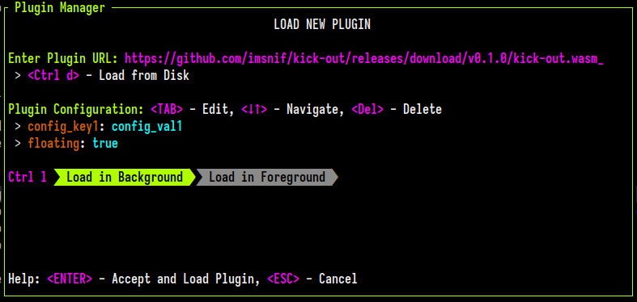

# Loading Plugins
Plugins can either be loaded through a [Layout](./creating-a-layout.md#plugin), through the [command line](./zellij-plugin-and-pipe.md#zellij-plugin), or from a [keybinding](keybindings-possible-actions.md#launchorfocusplugin).

## On startup
Plugins can also be loaded on startup through the `load_plugins` [configuration block](./configuration.md). Eg.

```
load_plugins {
    https://example.com/my-plugin.wasm
    file:/path/to/my/plugin.kdl
    my-plugin-alias
}
```
These plugins will be loaded in the background on session startup, only appearing once to request permissions from the user if they need any.

## Through the built-in `plugin-manager`
Plugins can also be loaded (in the background or foreground) through the plugin manager. This built-in plugin, accessible by default with `Ctrl o` + `p`, allows both loading plugins and monitoring existing plugins:




## Plugin URL schema
Plugins are referred to by URLs. Currently there are four supported schemas:
1. The file schema: `file:/absolute/path/to/my/plugin.wasm` - for reading plugins from the local HD
2. The built-in `zellij:` schema (eg. `zellij:bars`) for loading built-in zellij plugins.
3. Urls (`http(s)://path/to/my/plugin.wasm`)
4. Bare aliases (`filepicker`), see [Plugin Aliases](./plugin-aliases.md)

## Built-in plugins
These plugins are bundled with Zellij and can be loaded with the `zellij:` schema:

| Name | Description |
|------|-------------|
| `zellij:bars` | The tab bar, status bar and compact bar. Which bar it draws is chosen with its `role` configuration (`tab-bar`, `status-bar` or `compact-bar`) |
| `zellij:strider` | The file picker (see the [`filepicker` alias](./filepicker-alias.md)) |
| `zellij:session-manager` | The session manager and welcome screen |
| `zellij:configuration` | The [settings screen](./settings-screen.md) |
| `zellij:plugin-manager` | The plugin manager |
| `zellij:about` | The about screen |
| `zellij:share` | Web sharing of the session (see the [web client](./web-client.md)) |
| `zellij:multiple-select` | Selecting several panes at once |
| `zellij:layout-manager` | The layout manager |
| `zellij:prompt` | The popups used by [`zellij prompt`](./zellij-prompt.md) and the [`prompt`](./plugin-api-commands.md#prompt) plugin command (see the [`prompt` alias](./prompt-alias.md)) |
| `zellij:context-menu` | The right-click [context menu](./context-menu.md) (see the [`context-menu` alias](./context-menu-alias.md)) |

> **Note:** the tab bar, status bar and compact bar are one [shared plugin](./plugin-lifecycle.md#shared-plugins), `zellij:bars`. The names `zellij:tab-bar`, `zellij:status-bar` and `zellij:compact-bar` also work: they load `zellij:bars` with the matching `role`. The built-in `tab-bar`, `status-bar` and `compact-bar` [aliases](./plugin-aliases.md) point to `zellij:bars` as well.

Plugins loaded through `load_plugins` that need events from before any user is attached receive them once they have loaded.
