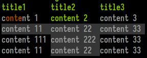
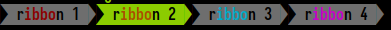
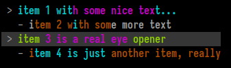
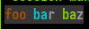

# Rendering a UI

## Rendering ANSI through STDOUT
When a plugin's render function prints to `STDOUT`, Zellij treats the printed bytes as utf-8 ANSI. One can print to a Zellij plugin just like one could print to any terminal and have it rendered, with the following exception:

Every time the render function is called, the previous state of the terminal is cleared. This is in order to facilitate UI development without having to keep track of the previous state on screen. This behavior might be toggleable in the future.

Plugin developers are free to use whichever terminal UI libraries they wish in order to render a Zellij plugin. Zellij also offers its own built-in components, described below.

## Using the Built-in UI Components
Zellij provides plugins with some built-in UI components that will fit the user's theme and preferences. These are cross-language components, interpreted through serialized STDOUT in the render function as a private terminal DCS extension. The various plugin SDKs provide wrappers to facilitate serialization. **All of these wrappers should be used inside the render function**

All components, helpers and types on this page are available through `use zellij_tile::prelude::*;`.

There are two kinds of components:
- [Display components](#display-components) (`Table`, `Ribbon`, `Nested List` and `Text`) only draw content.
- [Interactive components](#interactive-components) (buttons, toggles, text inputs, dropdowns, menus, dialogs and more), also handle keyboard and mouse input.

### Display Components

#### Table


Consists of a title line with an emphasis style and a grid of width-justified cells. Each cell can be styled individually (see `Text` below) and also marked as "selected". Marking adjacent cells as selected can create a "selected row" effect.

Example from the Rust SDK (renders the screenshot above):
```rust
let table = Table::new()
    .add_row(vec!["title1", "title2", "title3"])
    .add_styled_row(vec![Text::from("content 1").color_range(0, 1..5), Text::from("content 2").color_range(2, ..), Text::from("content 3")])
    .add_styled_row(vec![Text::from("content 11").selected(), Text::from("content 22").selected(), Text::from("content 33").selected()])
    .add_styled_row(vec![Text::from("content 111"), Text::from("content 222").selected(), Text::from("content 33")])
    .add_styled_row(vec![Text::from("content 11"), Text::from("content 22").selected(), Text::from("content 33")]);
print_table_with_coordinates(table, 4, 5, None, None);
```

`print_table_with_coordinates` prints the table at `x: 4, y: 5`. The last two `Option`s are its width and height. `print_table(table)` prints it wherever the cursor is at the moment. Both take the table by value, so use `table.clone()` to print the same table twice.

#### Ribbon


Ribbons are the UI elements used for tabs in the Zellij tab bar and for modes in the Zellij status-bar. They can be selected, which would change their background color, and can contain styled text themselves (see Text below).

Example from the Rust SDK (renders the screenshot above):
```rust
print_ribbon_with_coordinates(Text::from("ribbon 1").color_range(0, 1..5), 0, 0, Some(12), None);
print_ribbon_with_coordinates(Text::from("ribbon 2").color_range(1, 1..5).selected(), 12, 0,  Some(12), None);
print_ribbon_with_coordinates(Text::from("ribbon 3").color_range(2, 1..5), 24, 0, Some(12), None);
print_ribbon_with_coordinates(Text::from("ribbon 4").color_range(3, 1..5), 36, 0,  Some(12), None);
```

#### Nested List


A nested list is the UI element used in the Zellij session-manager. It is a list whose lines can be indented to any level. Each line can be selected (multiple lines can be selected as well), and each line can be styled individually (see Text below).

Each line is a `NestedListItem`, created from a `Text`. All styling is done on the `Text` before it is passed to `NestedListItem::new`. The item itself only has `indent(level)` and `selected()`.

Example from the Rust SDK (renders the screenshot above):
```rust
print_nested_list_with_coordinates(vec![
    NestedListItem::new(Text::from("item 1 with some nice text...").color_range(1, ..).color_range(3, 10..25).color_indices(1, vec![8])),
    NestedListItem::new(Text::from("item 2 with some more text").color_range(0, 1..15).color_indices(1, vec![8])).indent(1),
    NestedListItem::new(Text::from("item 3 is a real eye opener").color_range(2, ..).color_range(3, 5..20).color_indices(1, vec![8])).selected(),
    NestedListItem::new(Text::from("item 4 is just another item, really").color_range(0, ..).color_range(1, 1..15).color_indices(1, vec![8])).indent(1),
], 1, 1, None, None);
```

Coloring by substring works the same way:

```rust
NestedListItem::new(Text::from("my-session (2 tabs)").color_substring(0, "my-session").success_color_last_substring("(2 tabs)"))
```

#### Text


While this element can be rendered on its own, it's mainly used inside other elements for styling.

A `Text` element is created with `Text::from`, which accepts a `&str`, a `String`, a `&String` or a [`StyledText`](./plugin-api-types.md#styledtext). A `Text` can also be turned back into a `StyledText` with `StyledText::from(text)`.

A `Text` element can be selected - which will be interpreted in the context of the element it resides in, generally changing its background in one way or another.
A `Text` element can also have indices: character positions or ranges inside the element that get a special style. This can be especially useful when incorporated with fuzzy finding.

Example from the Rust SDK (renders the screenshot above):
```rust
let text = Text::from("foo bar baz").selected().color_range(0, 0..=2).color_range(1, 3..=5).color_range(2, 7..=9);
print_text_with_coordinates(text, 0, 0, None, None);
```

A `Text` element can also be marked as `disabled()`, which renders it dimmed to indicate that the thing it represents is currently unavailable:

```rust
print_text(Text::from("Not available right now").disabled());
```

`opaque()` gives the text an opaque background (see [Opaque](#opaque) below).

##### Styling methods

Indices are character positions (not bytes). Each styling method comes in several forms:

| Form | Example | Styles |
|---|---|---|
| `_indices(vec)` | `color_indices(0, vec![1, 3])` | The listed characters |
| `_range(range)` | `color_range(0, 2..5)` | A range of characters (any Rust range, eg. `..`, `3..`, `0..=2`) |
| `_substring(s)` | `color_substring(0, "foo")` | Every occurrence of `s` |
| `_nth_substring(s, n)` | `color_nth_substring(0, "foo", 1)` | The `n`th occurrence of `s` (counting from 0) |
| `_last_substring(s)` | `color_last_substring(0, "foo")` | The last occurrence of `s` |
| `_all()` | `color_all(0)` | The whole text |

The available styles:

| Methods | Effect |
|---|---|
| `color_*(color_index, ...)` | One of the 4 theme emphasis colors (`color_index` 0 to 3). All forms are available. |
| `error_color_*` | The theme's "error" color. All forms are available. |
| `success_color_*` | The theme's "success" color. All forms are available. |
| `dim_indices`, `dim_range`, `dim_substring`, `dim_all` | Dimmed |
| `unbold_indices`, `unbold_range`, `unbold_substring`, `unbold_all` | Not bold (text that has any styling is drawn bold by default) |
| `italic_range`, `italic_all` | Italic |
| `rgb_color_range([r, g, b], range)` | Any RGB color, regardless of the theme |

For example:

```rust
let text = Text::from("Saved 3 files, 1 failed")
    .success_color_substring("3 files")
    .error_color_last_substring("1 failed")
    .italic_range(0..5)
    .rgb_color_range([142, 78, 198], 15..16);
```

##### Measuring and wrapping

| Method | Returns |
|---|---|
| `content()` | The text itself, as `&str` |
| `len()` | The number of characters |
| `width()` | The number of terminal columns the text takes (wide characters and emoji count as 2) |
| `is_empty()` | Whether the text is empty |
| `is_plain()` | Whether the text has no styled indices |
| `wrap(width)` | A `Vec<Text>`, one per line, word-wrapped to `width` columns, keeping each character's styling |

`zellij_tile::graphemes::display_width(&str)` gives the column width of any string, the same way `width()` does.

### Interactive Components

`zellij-tile` includes components that react to the keyboard and mouse: [`Button`](#button), [`Toggle`](#toggle), [`TextInput`](#textinput), [`NumberStepper`](#numberstepper), [`Dropdown`](#dropdown), [`MenuList`](#menulist), [`SideMenu`](#sidemenu), [`ScrollView`](#scrollview) and [`ConfirmDialog`](#confirmdialog). [`FocusGroup`](#focusgroup) moves focus between several of them.

These are the components used by the built-in configuration screen, prompts and context menu.

#### How interactive components work

The plugin keeps each component in its state (they are not recreated on every render). Then:

1. **Rendering**: inside `render`, call the component's `render(..)` method (or `serialize(..)` to get the string instead of printing it). The method takes the position (and for some components the width and height) in the plugin's own coordinates. It also remembers where the component was drawn, which is used to tell which component a mouse click lands on. Because of this, mouse input only works on the same component that was rendered, and only at the position where it was last drawn.
2. **Input**: forward `Event::Key` and `Event::Mouse` events to the component's `handle_key(&key)` and `handle_mouse(mouse)`. These return a `UiResponse` saying what happened. The component updates its own state (text, selection, on/off...). If the response is anything other than `UiResponse::NotHandled`, the plugin should usually return `true` from `update` so it is rendered again.
3. **Subscribing**: the plugin needs to [subscribe](./plugin-api-commands.md#subscribe) to `EventType::Key` and `EventType::Mouse`. When using a `Button`, it should also subscribe to `EventType::Timer` (see [Button](#button)).

`UiResponse` has the following variants:

| Variant | Meaning |
|---|---|
| `Changed(UiValue)` | The value changed (eg. text was typed, a toggle was flipped, a new option was selected) |
| `Submitted(UiValue)` | The value was confirmed (eg. `Enter` in a text input, a menu item was chosen) |
| `Activated` | A button was pressed |
| `Cancelled` | The user backed out (eg. `Esc`) |
| `Consumed` | The input was used, but nothing the plugin needs to act on (eg. moving the cursor, hovering) |
| `NotHandled` | The component did not use this input |

`response.is_handled()` is `true` for anything other than `NotHandled`.

`UiValue` is one of `None`, `Bool(bool)`, `Index(usize)`, `Choice { index: usize, label: String }`, `Text(String)` or `Number(i64)`.

All interactive components implement the `Widget` trait, which provides:

| Method | Description |
|---|---|
| `handle_key(&KeyWithModifier) -> UiResponse` | Handle a key press |
| `handle_mouse(Mouse) -> UiResponse` | Handle a mouse event (`Mouse` is passed by value) |
| `set_focused(bool)`, `is_focused()` | Focus state. Only a focused component should get key presses. |
| `is_disabled()` | Whether the component is disabled |
| `last_area() -> Option<Rect>` | Where the component was last drawn |
| `clear_area()` | Forget where the component was drawn, so it no longer reacts to the mouse (useful when it is not rendered this time) |
| `hit_test(line, column) -> bool` | Whether a position is inside the last drawn area |
| `captures_input() -> bool` | `true` while an open dropdown list or dialog should receive all input |
| `handle_timer() -> bool` | Handle an `Event::Timer`. Returns `true` if the component needs to be rendered again. |

`Rect` has public `x`, `y`, `width` and `height` fields, as well as `contains(line, column)`, `bottom()` and `right()`.

Most components also have builder methods to create them already in a given state, eg. `.focused()`, `.disabled()` or `.hovered()`, as well as setters such as `set_disabled(bool)` to change them later.

#### Button

A clickable button, drawn as its label in brackets.

```rust
let mut button = Button::new("Save").accent_brackets();
```

- Created with `Button::new(label)`, where `label` is anything that converts into a `Text`.
- Builders: `accent_brackets()`, `left_aligned()`, `width(columns)`, `focused()`, `disabled()`, `pressed()`, `hovered()`.
- Other methods: `label()`, `set_label(label)`, `set_disabled(bool)`, `is_pressed()`, `is_hovered()`, `natural_width()` (the label width plus 4, unless `width` was set).
- Rendered with `render(x, y)`.
- `Enter` or `Space` while focused, or a left click, returns `UiResponse::Activated`.

A click shows the button as pressed for a short time (`BUTTON_PRESS_SECONDS`, 0.4 seconds). To do this, the button calls [`set_timeout`](./plugin-api-commands.md#set_timeout) itself. The plugin should subscribe to `EventType::Timer` and pass `Event::Timer` to `handle_timer()`, which returns `true` when the button needs to be rendered again.

#### Toggle

An on/off switch with a label, drawn as `Label [ on ]` or `Label [ off ]`.

```rust
let mut toggle = Toggle::new("Notifications", true).label_width(16);
```

- Created with `Toggle::new(label, on)`.
- Builders: `label_width(columns)` (to align several fields), `focused()`, `disabled()`, `hovered()`.
- Other methods: `is_on()`, `set_on(bool)`, `label()`, `set_disabled(bool)`, `set_field_width(columns)`, `width()`.
- Rendered with `render(x, y)`.
- `Enter`, `Space` or a click flips it and returns `UiResponse::Changed(UiValue::Bool(on))`.

#### TextInput

A single-line text field with a label, a cursor, undo/redo and optional validation.

```rust
let mut input = TextInput::new("my-layout")
    .label("Name")
    .placeholder("layout name")
    .validator(|text: &str| {
        if text.is_empty() {
            Err("The name cannot be empty".to_owned())
        } else {
            Ok(())
        }
    });
```

- Created with `TextInput::new(initial_text)` or `TextInput::empty()`.
- Builders:
  - `label(label)`, `label_width(columns)`, `accent_brackets()`
  - `placeholder(text)`: shown dimmed while the field is empty
  - `validator(closure)`: a `Fn(&str) -> Result<(), String>`. The error is shown on a second line under the field, and `Enter` is ignored while the text is invalid.
  - `accept(function)`: a `fn(char) -> bool` that decides which characters can be typed, eg. `accept(|c| c.is_ascii_digit())`
  - `search_mode()`: `Esc` clears the text first instead of cancelling
  - `focused()`, `disabled()`, `hovered()`
- Reading and changing the text: `get_text()`, `set_text(text)`, `get_text_mut()`, `drain_text()`, `clear()`, `is_empty()`.
- Editing from code: `insert_char`, `backspace`, `delete`, `delete_word_backward`, `delete_word_forward`, `move_left`, `move_right`, `move_word_left`, `move_word_right`, `move_to_start`, `move_to_end`, `undo`, `redo`, `can_undo`, `can_redo`.
- Other methods: `get_cursor_position()`, `set_cursor_position(position)`, `cursor_column()`, `set_show_cursor(bool)`, `set_match_count(Option<usize>)` (shows "N matches" at the end of the field), `validation_error()`, `is_valid()`, `height()` (2 when a validator is set, otherwise 1), `set_disabled(bool)`.
- Rendered with `render(x, y, width)`. The width includes the label.
- Keys:
  - Typing inserts characters and returns `Changed(UiValue::Text(text))`.
  - `Left`, `Right`, `Home`, `End`, `Backspace` and `Delete` work as usual. With `Ctrl` or `Alt`, the arrows, `Backspace` and `Delete` work on whole words.
  - `Ctrl a` and `Ctrl e` move to the start and end.
  - `Ctrl z` undoes. `Ctrl y` or `Ctrl Shift z` redoes.
  - `Enter` returns `Submitted(UiValue::Text(text))` if the text is valid.
  - `Esc` or `Ctrl c` returns `Cancelled`. In search mode, they first clear the text and return `Changed(UiValue::Text(""))`.
- A click inside the field moves the cursor there.

#### NumberStepper

A number field with arrows on both sides to decrease or increase it.

```rust
let mut stepper = NumberStepper::new("Columns", 80).min(10).max(500).step(10);
```

- Created with `NumberStepper::new(label, value)`, where `value` is an `i64`.
- Builders: `step(n)`, `min(n)`, `max(n)`, `decimals(d)`, `label_width(columns)`, `field_width(columns)`, `focused()`, `disabled()`, `hovered()`, `editing(text)`.
- With `decimals(d)` (up to 9), the stored value is the number multiplied by 10<sup>d</sup>. For example, with `decimals(1)` the value `15` is shown as `1.5`. `format_scaled(value, decimals)` and `parse_scaled(text, decimals)` convert between the two.
- Other methods: `value()`, `set_value(n)`, `display_value()`, `label()`, `is_editing()`, `edit_text()`, `at_min()`, `at_max()`, `width()`, `set_field_width(columns)`, `set_disabled(bool)`.
- Rendered with `render(x, y)`.
- `Left` and `Right`, or clicking the arrows, change the value by one step and return `Changed(UiValue::Number(value))`.
- Typing digits (and `-`, or `.` with decimals) starts editing the number directly. `Enter` confirms the typed number (kept within `min` and `max`), and `Esc` cancels the edit. Moving focus away also confirms it.

#### Dropdown

A field showing the selected option. When opened, it shows a list of options below the field (or above it, when there is no room below).

```rust
let mut dropdown = Dropdown::new("Theme", vec!["dracula", "gruvbox", "nord"]).selected(1);
```

- Created with `Dropdown::new(label, options)`, where `options` is a `Vec` of anything that converts into a `String`.
- Builders: `selected(index)`, `label_width(columns)`, `max_list_rows(rows)` (8 by default), `accent_brackets()`, `arrow(text)`, `styled_value(text)`, `hover_emphasis()`, `bold_value()`, `focused()`, `disabled()`, `hovered()`, `opened()`.
- Other methods: `options()`, `set_options(options)`, `selected_index()`, `selected_value()`, `set_selected(index)`, `label()`, `set_disabled(bool)`, `is_open()`, `open()`, `close()`, `highlighted_index()`, `set_highlighted_index(index)`, `opens_upward()`, `list_area()`.
- The field is rendered with `render(x, y, width)`. **The open list is rendered separately with `render_overlay(rows, cols)`**, which should be called after everything else so the list is drawn on top. `rows` and `cols` are the plugin's size, as received in `render`.
- While closed:
  - `Enter`, `Space` or a click opens the list.
  - `Left` and `Right` select the previous or next option and return `Changed(UiValue::Choice { index, label })`.
- While open:
  - `Up`, `Down`, `PageUp`, `PageDown`, `Home`, `End` and typing a letter move the highlight.
  - `Enter`, `Space` or a click on an option selects it, closes the list and returns `Changed(UiValue::Choice { index, label })`.
  - `Esc` or a click outside the list closes it and returns `Cancelled`.
  - `Tab` closes it and returns `NotHandled`, so that focus can move on.

#### MenuList

A vertical list of items, like a context menu. Each item is a `MenuItem`.

```rust
let mut menu = MenuList::new(vec![
    MenuItem::new("Rename").shortcut("r"),
    MenuItem::new("Close").shortcut("x"),
    MenuItem::separator(),
    MenuItem::new("Unavailable").disabled(),
])
.with_border()
.focused();
```

- `MenuItem::new(label)` or `MenuItem::separator()`. Builders: `shortcut(text)`, `disabled()`, `marked()` (shows a check mark), `matched_indices(vec)` and `emphasized_indices(vec)` (highlight characters of the label, eg. fuzzy matches). Getters: `label()`, `shortcut_text()`, `is_separator()`, `is_disabled()`, `is_marked()`, `is_selectable()`, `matched()`, `emphasized()`. Setter: `set_marked(bool)`.
- `MenuList::new(items)`. Builders: `with_border()`, `without_mark_column()`, `highlighted(index)`, `focused()`.
- Other methods: `items()`, `set_items(items)`, `highlighted_index()`, `highlighted_item()`, `set_highlighted(Option<usize>)`, `scroll_offset()`, `scroll_by(rows)`, `natural_width()`, `height_for(max_height)`, `item_at(line, column)`, `has_border()`, `is_hovered()`.
- Rendered with `render(x, y, width, max_height)`. When the items do not fit, the list scrolls and shows how many items are above and below. Clicking those lines scrolls by a page.
- Keys: `Up` and `Down` (wrapping around), `PageUp`, `PageDown`, `Home` and `End` move the highlight, skipping separators and disabled items. Typing a letter or digit jumps to the next item starting with it. `Enter` returns `Submitted(UiValue::Choice { index, label })`. `Esc` returns `Cancelled`.
- Mouse: hovering highlights an item, a click returns `Submitted(UiValue::Choice { index, label })`, and the scroll wheel scrolls the list.

#### SideMenu

A vertical list of section names with one selected entry, like the sidebar of a settings screen.

```rust
let mut side_menu = SideMenu::new(vec!["General", "Keybindings", "Themes"]).focused();
```

- Created with `SideMenu::new(items)`, where `items` is a `Vec` of anything that converts into a `String`.
- Builders: `selected(index)`, `focused()`, `hovered_item(index)`.
- Other methods: `items()`, `set_items(items)`, `selected_index()`, `selected_label()`, `set_selected(index)`, `hovered_index()`, `scroll_offset()`, `scroll_by(rows)`, `item_at(line, column)`.
- Rendered with `render(x, y, width, height)`. Like `MenuList`, it scrolls when the items do not fit.
- `Up` and `Down` (wrapping around), `Home`, `End` or a click select an item and return `Changed(UiValue::Choice { index, label })`. `Enter` returns `Submitted(UiValue::Choice { index, label })`. The scroll wheel scrolls the list.

#### ScrollView

`ScrollView` does not draw content. It keeps track of which rows of a long piece of content are visible, and draws a scrollbar and "more above/below" indicators next to it. The plugin draws the visible rows itself.

For example, with a `lines: Vec<String>` and a `scroll: ScrollView` in the plugin's state, inside `render(&mut self, rows: usize, cols: usize)`:

```rust
self.scroll.set_total_rows(self.lines.len());
let visible = self.scroll.layout(0, 0, cols, rows);
let content_width = self.scroll.content_width();
for row in visible {
    if let Some(y) = self.scroll.screen_row(row) {
        print_text_with_coordinates(Text::from(&self.lines[row]), 0, y, Some(content_width), None);
    }
}
self.scroll.render_indicators();
```

- Created with `ScrollView::new(total_rows)`. Builder: `focused()`.
- `layout(x, y, width, height)` sets the area and returns the range of rows to draw.
- Positions: `screen_row(row)` (the line on screen of a content row, if visible), `row_at(line)` (the content row at a screen line), `content_y()`, `content_width()` (the width left after the scrollbar), `gutter_width()`, `viewport_height()`, `needs_indicators()`.
- Scrolling: `offset()`, `set_offset(row)`, `scroll_by(rows)`, `page_up()`, `page_down()`, `ensure_visible(row)`, `ensure_range_visible(start, height)`, `is_row_range_visible(start, height)`, `visible_range()`, `rows_above()`, `rows_below()`.
- Other methods: `total_rows()`, `set_total_rows(rows)`, `is_hovered()`, `is_dragging()`.
- The scrollbar is drawn with `render_indicators()`, which draws nothing if all rows fit.
- `PageUp` and `PageDown`, the scroll wheel (while hovering the area), clicking the indicators and dragging the scrollbar scroll the view and return `Changed(UiValue::Index(offset))`.

#### ConfirmDialog

A framed dialog with a title, a message and a row of buttons. It is drawn only while open, and while open it takes all keyboard and mouse input (`captures_input()` returns `true`).

```rust
let mut dialog = ConfirmDialog::new("Delete layout", "This cannot be undone.")
    .buttons(vec!["Delete", "Cancel"])
    .selected(1);
dialog.open();
```

- Created with `ConfirmDialog::new(title, message)`, where `message` is anything that converts into a `Text`. The default buttons are `OK` and `Cancel`.
- Builders: `buttons(labels)`, `selected(index)`, `width(columns)` (at least 16, 50 by default), `centered()` (center the message lines), `footer_rows(rows)` (reserve rows under the buttons for the plugin to draw in, see `footer_area()`), `hovered_button(index)`, `opened()`.
- Other methods: `open()`, `open_with_selected(index)`, `close()`, `is_open()`, `title()`, `set_message(message)`, `button_labels()`, `selected_index()`, `button_areas()`, `footer_area()`, `size_for(cols)`.
- Rendered with `render_centered(rows, cols)` (centered in the plugin) or `render(x, y, width, max_height)`. The message is word-wrapped to fit.
- `Tab`, `Shift Tab`, `Left` and `Right` move between buttons. `Enter`, `Space` or a click on a button closes the dialog and returns `Submitted(UiValue::Choice { index, label })` for that button. `Esc` closes it and returns `Cancelled`.

For example, in `update`, with `dialog: ConfirmDialog` and `confirmed: bool` in the plugin's state:

```rust
if let Event::Key(key) = event {
    match self.dialog.handle_key(&key) {
        UiResponse::Submitted(UiValue::Choice { index: 0, .. }) => {
            self.confirmed = true;
        },
        UiResponse::NotHandled => return false,
        _ => {},
    }
    return true;
}
```

#### FocusGroup

A `FocusGroup` holds several components, each with a key chosen by the plugin (any type that is `Clone + PartialEq`, eg. a `&'static str` or an enum). It sends key presses to the focused component, moves focus with `Tab` and `Shift Tab`, and sends mouse events to the right component.

A `FocusGroup` can hold `Button`, `Toggle`, `Dropdown`, `TextInput`, `NumberStepper`, `MenuList` and `SideMenu` components. `ConfirmDialog` and `ScrollView` are used on their own.

- Created with `FocusGroup::new()`. Builders: `with(key, component)`, `wrap(bool)` (whether `Tab` on the last component goes back to the first, `true` by default).
- Adding and removing: `add(key, component)`, `remove(&key)`, `len()`, `is_empty()`, `keys()`.
- Getting a component back: `get(&key)` and `get_mut(&key)` return an `Element` (an enum of the supported components). There are also typed getters, which return `None` if the key belongs to another kind of component: `button`, `toggle`, `dropdown`, `text_input`, `number_stepper`, `menu_list`, `side_menu` and their `_mut` versions (eg. `text_input_mut(&key)`).
- Focus: `focused_key()`, `is_focused(&key)`, `focus(&key)`, `focus_first()`, `focus_next()`, `focus_prev()`, `blur()`. Disabled components are skipped.
- Rendering: each component is rendered by the plugin (through the `_mut` getters). Call `clear_areas()` at the start of `render`, so that components not rendered this time do not react to the mouse. Call `render_overlays(rows, cols)` at the end, to draw any open dropdown list on top.
- Input: `handle_key(&key)` and `handle_mouse(mouse)` return a `FocusEvent`:
  - `FocusEvent::Element { key, response }`: a component handled the input, with its `UiResponse`.
  - `FocusEvent::FocusChanged(key)`: focus moved to another component.
  - `FocusEvent::NotHandled`: nothing used the input.
- Other methods: `handle_timer()` (pass `Event::Timer` here when the group has buttons), `has_open_overlay()`, `capturing_key()`, `element_at(line, column)`, `area_of(&key)`.

##### A complete example

A small form with a text input, a dropdown, a toggle and a button:

```rust
use std::collections::BTreeMap;
use zellij_tile::prelude::*;

struct State {
    form: FocusGroup<&'static str>,
    status: String,
}

impl Default for State {
    fn default() -> Self {
        let mut form = FocusGroup::new()
            .with("name", TextInput::empty().label("Name").label_width(8).placeholder("your name"))
            .with("level", Dropdown::new("Level", vec!["low", "medium", "high"]).label_width(8))
            .with("notify", Toggle::new("Notify", true).label_width(8))
            .with("save", Button::new("Save"));
        form.focus_first();
        State {
            form,
            status: String::new(),
        }
    }
}

register_plugin!(State);

impl ZellijPlugin for State {
    fn load(&mut self, _configuration: BTreeMap<String, String>) {
        subscribe(&[EventType::Key, EventType::Mouse, EventType::Timer]);
    }

    fn update(&mut self, event: Event) -> bool {
        match event {
            Event::Key(key) => {
                let focus_event = self.form.handle_key(&key);
                self.handle_form_event(focus_event)
            },
            Event::Mouse(mouse) => {
                let focus_event = self.form.handle_mouse(mouse);
                self.handle_form_event(focus_event)
            },
            Event::Timer(_) => self.form.handle_timer(),
            _ => false,
        }
    }

    fn render(&mut self, rows: usize, cols: usize) {
        self.form.clear_areas();
        let width = cols.min(40);
        if let Some(input) = self.form.text_input_mut(&"name") {
            input.render(0, 0, width);
        }
        if let Some(dropdown) = self.form.dropdown_mut(&"level") {
            dropdown.render(0, 2, width);
        }
        if let Some(toggle) = self.form.toggle_mut(&"notify") {
            toggle.render(0, 4);
        }
        if let Some(button) = self.form.button_mut(&"save") {
            button.render(0, 6);
        }
        print_text_with_coordinates(Text::from(&self.status), 0, 8, None, None);
        self.form.render_overlays(rows, cols);
    }
}

impl State {
    fn handle_form_event(&mut self, focus_event: FocusEvent<&'static str>) -> bool {
        match focus_event {
            FocusEvent::Element {
                key: "save",
                response: UiResponse::Activated,
            } => {
                let name = self
                    .form
                    .text_input(&"name")
                    .map(|input| input.get_text().to_owned())
                    .unwrap_or_default();
                let level = self
                    .form
                    .dropdown(&"level")
                    .and_then(|dropdown| dropdown.selected_value())
                    .unwrap_or_default()
                    .to_owned();
                let notify = self
                    .form
                    .toggle(&"notify")
                    .map(|toggle| toggle.is_on())
                    .unwrap_or(false);
                self.status = format!("Saved: {}, {}, notify: {}", name, level, notify);
                true
            },
            FocusEvent::NotHandled => false,
            _ => true,
        }
    }
}
```

`State` implements `Default` by hand because the form is built when the plugin starts. Every handled event returns `true`, so the form is rendered again after typing, focus changes and hovering.

### The Protocol
*Note: This section discusses the private DCS ANSI serialization protocol used to represent the above components. It could be of interest to SDK authors, but plugin developers are encouraged to use the SDK abstractions instead.*

An example component can look like this: (`<ESC>`, represents the escape character)
```
<ESC>Pzribbon;27,91,49,109,60,27,91,51,56,59,53,59,57,109,110,27,91,51,57,59,51,56,59,53,59,48,109,62,32,82,69,83,73,90,69<ESC>\
```
The first part of the sequence, `<ESC>Pz` is the DCS representing the beginning of a Zellij UI element, followed by the clear-text element name. Following is a semi-colon (`;`) separated list of items to be interpreted according to context. In the above case there's only one item representing a utf-8 encoded byte-string which is the ribbon's contents (the bytes separated by commas). Finally, the string terminator `<ESC>\` representing the end of the UI element.

#### Coordinates

Each component can have an optional coordinates string, placed as the first element in the semi-colon separated list directly after the component name. For [interactive components](#interactive-components) the coordinates are required.
Example:

```
<ESC>Pzribbon;2/3/10/5;114,105,98,98,111,110,32,49<ESC>\
```

Here, the coordinate string `2/3/10/5` instructs us to render the ribbon at `x: 2, y: 3, width: 10, height: 5`. The width and height are optional, so may be empty (eg. `2/3//`).

#### Selected
If a utf-8 separated byte list begins with a clear-text `x`, it will be considered "selected". Eg.

```
<ESC>Pzribbon;x114,105,98,98,111,110,32,49<ESC>\
```

#### Opaque
If a utf-8 separated byte list begins with a clear-text `z` (note: must follow `Selected` if both are present), it will be considered "opaque". Eg.

```
<ESC>Pztext;z114,105,98,98,111,110,32,49<ESC>\
```

This indicates that the UI component should use an opaque background, defaulting to the user's `black` theme color. Otherwise it will be considered transparent and use no background (when possible).
Opaque components are best used as part of status bars, transparent components when one wishes to represent bare text (for example, in help text).

#### Disabled
If a utf-8 separated byte list begins with a clear-text `d` (note: must follow `Selected` and `Opaque` if they are present), it will be rendered dimmed, as "disabled". Eg.

```
<ESC>Pztext;d114,105,98,98,111,110,32,49<ESC>\
```

#### Indices
A utf-8 separated byte list can be preceded by a dollar (`$`) separated index list representing styled indices. Each element within the dollar separated list can contain zero or more indexes (separated by commas), which are character positions in the text (not byte positions). The position of the element in the list (its "level") decides the style:

| Level | Style |
|---|---|
| 0 to 3 | The 4 theme emphasis colors |
| 4 | Dimmed |
| 5 | Not bold |
| 6 | The theme's "error" color |
| 7 | The theme's "success" color |
| 8 | Italic |
| 9 and above | A custom RGB color (see below) |

Example:
```
<ESC>Pzribbon;2/2/10/;1,2,3,4$5,6$$7$114,105,98,98,111,110,32,49<ESC>\
```
Here, indices 1, 2, 3 and 4 will be colored in index color 0 while 5 and 6 will be colored in index color 1. Index color 2 is empty, so no elements will be colored using it, and element number 7 will be colored in index color 3.

A custom color level (9 and above) contains one marker value, `1073741824` (`1 << 30`) plus the color as `0xRRGGBB`, followed by the indices to paint in that color. Each color uses its own level. For example, `1083068102,0,1` (`1073741824 + 0x8e4ec6`) paints characters 0 and 1 in `#8e4ec6`.

#### Indentation
In the context of a Nested List, elements can be arbitrarily indented. This is done one or more pipe (`|`) characters preceding the utf-8 byte list.
Example:
```
<ESC>Pznested_list;105,116,101,109,32,51;|105,116,101,109,32,52;||105,116,101,109,32,53,32,108,115<ESC>\
```
Each item in a Nested List is represented as a utf-8 byte array separated by semicolons. Here, the first item will not be indented, the second item will be indented once, and the third item will be indented twice.

#### Table
A table is sent as the number of columns, the number of rows, and then one cell after the other (row by row), all separated by semicolons. Each cell is a text element as described above. The first row is the title row. A table must have at least one column.
Example (2 columns, 2 rows):
```
<ESC>Pztable;2;2;97;98;99;100<ESC>\
```

#### Interactive Component Encoding
Interactive components use the following form:
```
<ESC>Pz<name>;<x>/<y>/<width>/<height>;<state>;<field>;<field>...<ESC>\
```

- The coordinates are required.
- `<state>` is a comma-separated list of flags (eg. `f`) and `key=value` pairs (eg. `lw=8`). It can be empty.
- Each field is either a text element (with the prefixes and indices described above) or a plain utf-8 byte list, depending on the component.

The flags common to most components are: `f` (focused), `d` (disabled), `h` (hovered), `ab` (accented brackets), and `lw=<columns>` (the width of the label column).

| Name | State | Fields |
|---|---|---|
| `button` | `f`, `d`, `p` (pressed), `h`, `ab`, `la` (left-aligned label) | label (text element) |
| `toggle` | `f`, `d`, `on`, `h`, `lw=` | label (text element) |
| `text_input` | `f`, `d`, `ph` (showing the placeholder), `err` (invalid), `h`, `ab`, `lw=`, `cur=<position>` (cursor, only when shown) | label (text element), visible text or placeholder, error message, suffix (eg. `3 matches`), the last three as byte lists |
| `stepper` | `f`, `d`, `e` (editing), `lmin` / `lmax` (at the minimum / maximum), `h`, `hdec` / `hinc` (hovering the decrease / increase arrow), `lw=`, `cur=` (while editing) | label (text element), value as a byte list |
| `dropdown` | `f`, `d`, `o` (open), `h`, `ab`, `he` (hover emphasis), `bv` (bold value), `lw=` | label (text element), selected value (byte list), and optionally the arrow (byte list) and a styled value (text element) |
| `menu` | `b` (border), `f`, `ind` (show "more above/below" lines), `nm` (no mark column), `hl=<row>` (highlighted visible row), `above=<n>`, `below=<n>` (hidden items), `hu` / `hd` (hovering the upper / lower indicator) | one per visible item (see below) |
| `side_menu` | `f`, `ind`, `sel=<row>` (selected visible row), `hov=<row>` (hovered visible row), `above=<n>`, `below=<n>`, `hu`, `hd` | one byte list per visible item |
| `dialog` | `sel=<index>` (selected button), `nb=<n>` (number of buttons), `bx=<column>` (where the buttons start), `fr=<rows>` (footer rows), `c` (centered message), `hb=<index>` (hovered button) | title (byte list), one byte list per button label, then one text element per message line |
| `scroll_indicator` | `bar`, `f`, `tot=<rows>` (total rows), `off=<row>` (first visible row), `above=<n>`, `below=<n>`, `hu`, `hd` | none |

A `menu` item is `-` for a separator. Otherwise it is an optional `d` (disabled) and `m` (marked) prefix, the label as a byte list, then optionally `:` and the shortcut as a byte list, then optionally `/` and the comma-separated matched indices, and `/` and the comma-separated emphasized indices.
