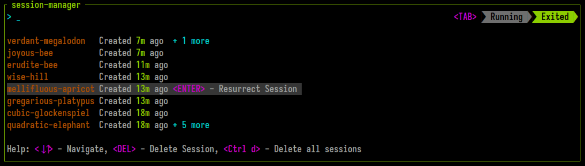
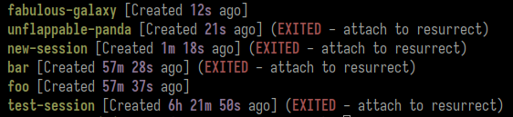

# Session Resurrection

Zellij includes built-in session resurrection capabilities. This means that by default, each Zellij session is serialized and kept in the user's cache folder waiting to be recreated after an intentional quit or an unintentional crash.

These exited resurrectable sessions can be listed through the CLI or the built-in `session-manager`. They can be resurrected through the CLI by attaching to them or through the `session-manager` by selecting them in the `EXITED` section.

## What is Resurrected and how to Configure
By default, Zellij serializes the session layout (panes and tabs) and the command running in each pane (it will re-run them in command panes). Through configuration it's possible to have Zellij also serialize and resurrect the pane viewport and scrollback.

Tabs are serialized in the order in which they appear in the session, so tabs that were reordered by the user keep their position when the session is resurrected.

Zellij does not immediately run resurrected commands, but rather places them behind a "Press `ENTER` to run..." banner so as to prevent uncomfortable accidents with things like `rm -rf`.

The following are also kept when a session is resurrected:

- each pane's [border style](./creating-a-layout.md#border_style)
- the [orientation of stacks](./creating-a-layout.md#stack_orientation) (titles in a column or in a row)
- muted panes, tabs and sessions, and panes whose output is ignored (see [the inbox](./inbox.md))

## Setting the command a pane is resurrected with
A program can tell Zellij which command should be used to bring its pane back, instead of the command Zellij detects. This is useful for programs that can resume where they left off when started with different arguments (for example a chat or agent program that resumes a conversation by its id):

```
$ zellij action set-resurrect-command -- opencode -s ses_abc123
$ zellij action set-resurrect-command --pane-id terminal_3 --cwd /path/to/project -- my-tool --resume
$ zellij action set-resurrect-command --clear
```

- `--pane-id` - the terminal pane to set the command for (eg. `terminal_3` or `3`). If omitted, `$ZELLIJ_PANE_ID` is used, which means a program can run this command inside its own pane without arguments. Plugin panes are not supported.
- `--cwd` - the folder to resurrect the pane in. A relative path is taken from the folder the command is run in.
- `--clear` - remove a command set earlier, so that the detected command is used again. It cannot be combined with a command or `--cwd`.

The command given takes precedence over the detected command, including the output of the [`post_command_discovery_hook`](#post_command_discovery_hook). It stays in place until it is cleared or the pane is closed. Like other resurrected commands, it is placed behind the "Press `ENTER` to run..." banner unless `--force-run-commands` is used.

### `session_serialization`
To disable session serialization (and thus also resurrection), set `session_serialization false` in the [config](./configuration.md).

### `serialize_pane_viewport`
When `session_serialization` is enabled, setting `serialize_pane_viewport` to `true` in the [config](./configuration.md) will also serialize the pane viewport (the part of the terminal visible on screen).

### `scrollback_lines_to_serialize`
When `serialize_pane_viewport` is enabled, setting `scrollback_lines_to_serialize` to `0` in the [config](./configuration.md) will serialize all scrollback and to any other number will serialize line number up to that scrollback. Note that this might incur higher resource utilization (and certainly a higher cache folder usage...)

### `post_command_discovery_hook`
When Zellij attempts to discover commands running inside panes so that it can serialize them, it can sometimes be inaccurate. This can happen when (for example) commands are run inside some sort of wrapper. To get around this, it's possible to define a `post_command_discovery_hook`. This is a command that will run in the context of the user's default shell and be provided the `$RESURRECT_COMMAND` that has just been discovered for a specific pane and not yet serialized. Whatever this command sends over `STDOUT` will be serialized in place of the discovered command.

Example:
```javascript
post_command_discovery_hook "echo \"$RESURRECT_COMMAND\" | sed 's/^sudo\\s\\+//'" // strip sudo from commands
```

## Resurrecting Sessions through the CLI
To list exited sessions, use `zellij list-sessions` (or `zellij ls`) for short:



Then, in order to resurrect a session, one can `attach` to it. If you'd like to immediately run all resurrected commands and skip the "Press `ENTER` to run..." banner, you can issue the `--force-run-commands` flag.

Attaching to a session that is still running never reads its saved layout, so a saved layout that cannot be loaded does not prevent attaching to the running session.

## Resurrecting Sessions through the session-manager
Sessions can also be resurrected and switched to from within a Zellij session using the `session-manager`. Exited sessions are listed in an `Exited` group at the end of the session list. Open the group with `<RIGHT>` or `<ENTER>` (and close it with `<LEFT>`), then select a session with `<ENTER>`. Typing the name of an exited session and pressing `<ENTER>` resurrects it as well.

## Permanently Deleting Sessions
Resurrectable sessions can be permanently deleted with the `zellij delete-session` or `zellij delete-all-sessions` CLI commands. They can also be deleted from the `session-manager`.

## Session files in the cache
Zellij serializes the session data into a [layout](./layouts.md) and saves it to the system's cache folder. By default this happens every 60 seconds; the interval can be changed with the [`serialization_interval`](./options.md#serialization_interval) option. These layouts can later be examined, altered and even shared as is across machines. They can be loaded with `zellij --layout session-layout.kdl` just like any other layout. They are intentionally Human readable to facilitate their re-use.

A `$` in a saved path or command is written as `$$`, since `$NAME` in a layout is replaced with the value of the environment variable `NAME`.

Each session's folder in the cache (and its socket) is named after a short id of 12 hexadecimal characters (eg. `3f9a1c07b2de`), rather than after the session's name. The saved layout of a session is at `contract_version_1/session_info/<id>/session-layout.kdl` inside Zellij's cache folder. Zellij keeps a list matching names to ids in the `session_index.sqlite` file next to the `session_info` folder, so renaming a session does not rename anything on disk. Sessions created by earlier versions keep their name as their id.
