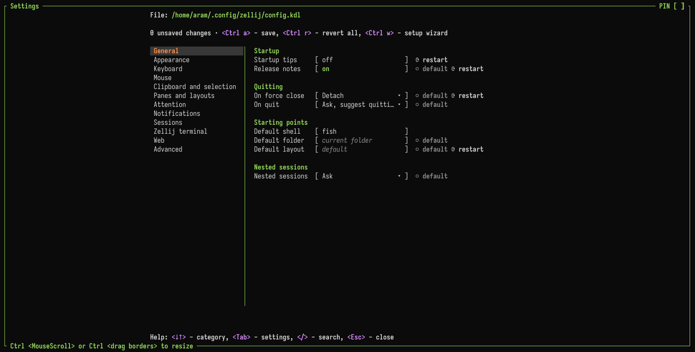

# Settings Screen

Zellij includes a settings screen that changes its behavior and appearance without editing the [configuration file](./configuration.md) by hand. The settings screen reads the configuration file and writes its changes back to it, so both can be used side by side.

## Opening the settings screen

- `Ctrl o` + `c` in the default preset (`Ctrl g` + `o` + `c` in the Unlock-First preset)
- "Settings…" in the [right-click menu](./context-menu.md)
- Loading the [configuration alias](./configuration-alias.md), optionally at a specific page

## Categories

The settings are grouped in these categories:

- General
- Appearance - with the Themes and Pane borders pages
- Keyboard - with the Key bindings page, where the [keybinding preset](./keybinding-presets.md) and its leader keys are chosen
- Mouse - with the [Mouse bindings](./mouse-bindings.md) and [Right-click menu](./context-menu.md) pages
- Clipboard and selection
- Panes and layouts
- Attention - see [Inbox & Attention](./inbox.md#configuration)
- Notifications
- Sessions
- Zellij terminal - settings that only apply in the [Zellij terminal](./zellij-terminal.md), see [Terminal Options](./terminal-options.md)
- Web - see [Web Client](./web-client.md)
- Advanced - with the Plugins and environment page (plugin aliases, plugins loaded at start, environment variables and plugin settings)

Below the selected setting, the screen shows its description, its default, whether it applies only to you or to everyone in the session, and whether it takes effect only after a restart.

## Keys

| Key | Action |
|:----|:-------|
| `↓` `↑` | Move between categories or settings |
| `Tab` | Open the selected category |
| `←` | Back to the categories |
| `Enter` | Edit the selected setting |
| `Space` | Change a toggle or a choice |
| `/` | Search all settings |
| `r` | Revert the selected setting to the value in the configuration file |
| `?` | Help for the selected setting |
| `Ctrl a` | Save all changes to the configuration file |
| `Ctrl r` | Revert all unsaved changes |
| `Ctrl w` | Open the [setup screen](./desktop-setup.md#the-setup-screen) |
| `Esc` | Close (or go back from a page) |

## Saving

A change applies to the running session right away. `Ctrl a` writes all unsaved changes to the configuration file. Changes that are not saved stay applied to the session until it ends.

When writing, Zellij keeps the comments and the formatting of the configuration file. If the file was changed outside the settings screen in the meantime, Zellij asks whether to overwrite it with the unsaved changes or to read it again and keep the changes unsaved.

Some items are shown but cannot be edited:

- Built-in themes and themes from `theme_dir` (copy one to edit it)
- Keybindings that come from a [layout](./layouts-with-config.md)

Without a configuration file, the settings screen still changes the session but cannot save.

## Plugin settings

Plugins can add their own entry to the "Plugin settings" section of the Plugins and environment page. Selecting it opens that plugin's own settings.
