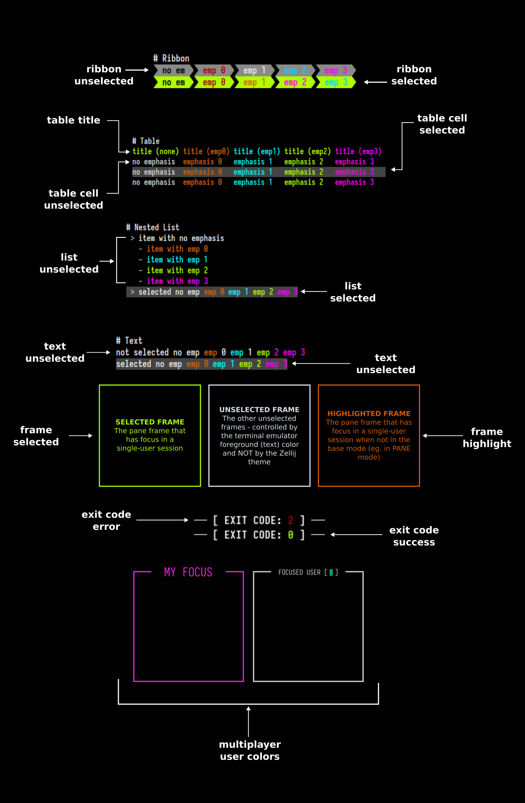
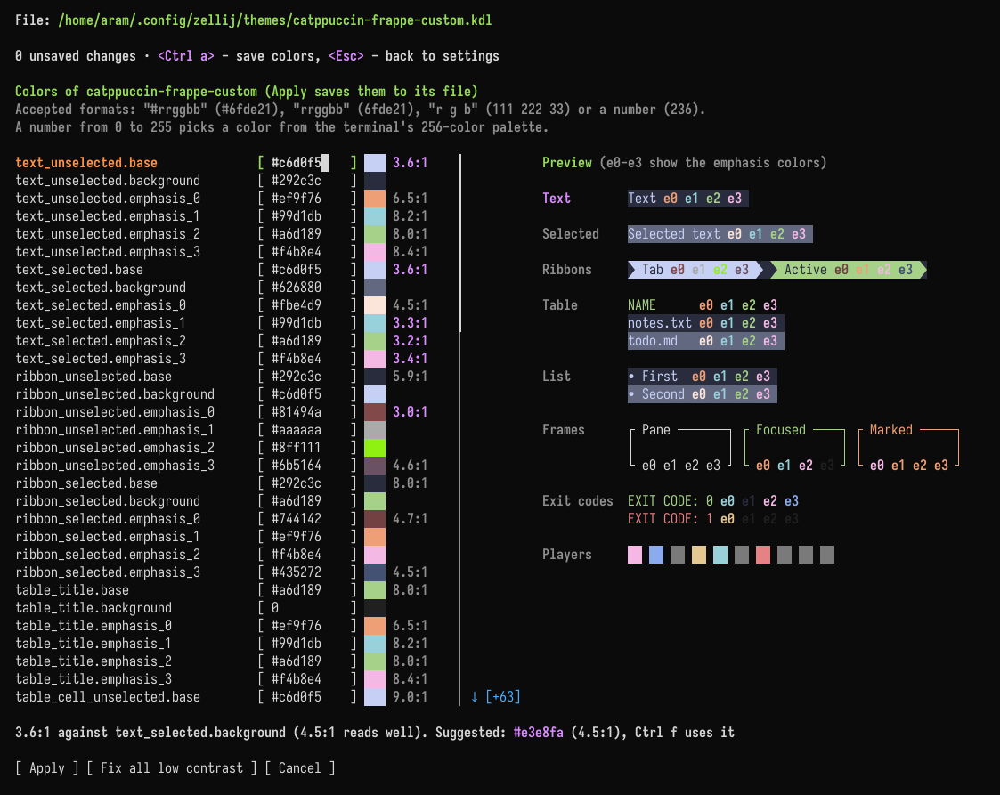

# Themes

## Using the built-in themes
The built-in themes in Zellij can be used by setting the `theme [THEME_NAME]` in the [configuration file](./configuration.md). Take a look at the [list of themes](./theme-list.md) to see what's possible.

Since `0.46.0`, the `default` theme has a new palette, and is paired with a new `default-light` theme. The theme that was called `default` before `0.46.0` is bundled as `classic`:

```javascript
theme "classic"
```

## Automatic dark and light theme switching
When none of [`theme`](./options.md#theme), [`theme_dark`](./options.md#theme_dark) and [`theme_light`](./options.md#theme_light) is set, Zellij switches automatically between the bundled `default` theme (when the host terminal is in dark mode) and `default-light` (when it is in light mode).

Other themes can be chosen for each mode:

```javascript
theme_dark "catppuccin-mocha"
theme_light "catppuccin-latte"
```

How these options combine:

| Set in the configuration | Result |
|---|---|
| nothing | switches between `default` and `default-light` |
| `theme_dark` and `theme_light` | switches between the two (with or without `theme`) |
| only `theme_dark` | switches between it and `default-light` |
| only `theme_light` | switches between `default` and it |
| `theme`, with at most one of `theme_dark` / `theme_light` | no switching, `theme` is always used |

Zellij detects the color scheme of the terminal it is attached to (through `DSR 997` replies and `CSI 2031` change notifications) and switches themes when it changes. Terminals that do not report their color scheme will not trigger switching.

The theme can also be switched manually, with these actions (bindable in the [`keybinds`](./keybindings.md) block) and their CLI equivalents:

| Action | CLI |
|---|---|
| [`SetDarkTheme`](./keybindings-possible-actions.md#setdarktheme) | `zellij action set-dark-theme` |
| [`SetLightTheme`](./keybindings-possible-actions.md#setlighttheme) | `zellij action set-light-theme` |
| [`ToggleTheme`](./keybindings-possible-actions.md#toggletheme) | `zellij action toggle-theme` |

Programs running inside panes can subscribe to color scheme changes themselves with `CSI ? 2031 h` and will receive `CSI ?997;1 n` (dark) or `CSI ?997;2 n` (light) whenever the mode changes.

## Overriding the terminal's reported hue
The [`explicit_theme_hue`](./options.md#explicit_theme_hue) option pins the session to a dark or light appearance, ignoring what the host terminal reports:

```javascript
explicit_theme_hue "dark"
```

It is resolved before the first render, so the session starts with the intended appearance instead of correcting itself once the terminal replies. This is useful for terminals that report the wrong color scheme, or that do not report one at all. When it is unset, the host terminal decides.

It only selects which of the dark and light themes applies, following the table [above](#automatic-dark-and-light-theme-switching). When `theme` is set and switching is off, it has no effect.

## Theme Definition Specification
Themes in Zellij are defined according to UI components. These components are used in the various plugins that make up the Zellij interface, and can also be used dynamically in user plugins.




## Structure of a theme definition
> **Note:** the easiest way to create or change a theme is the [theme editor](#the-theme-editor), which shows a preview of the colors and can fix colors that are hard to read. The structure below is what it writes to the theme file.

A theme definition is a `KDL` file (or part of one). It has a node named `themes`, with a node inside it named after the theme, and inside that a list of nodes defining the UI components:
```javascript
themes {
    dracula {
        ribbon_unselected {
            base 0 0 0
            background 255 153 0
            emphasis_0 255 53 94
            emphasis_1 255 255 255
            emphasis_2 0 217 227
            emphasis_3 255 0 255
        }
    }
}
```

A full theme has one such node for each of the components listed below.

It can either be placed directly in the main [configuration file](./configuration.md) or in a [separate directory](#getting-zellij-to-pick-up-the-theme).

### Theme UI Components
Components have the following attributes, each one including a space separated list of three numbers representing the `RGB` color. A color can also be given as a hex string (eg. `"#ff8c00"` or `"#f80"`) or as a single number from the 256-color palette.
1. `base` - the base color of the component
2. `background` - the background color of the component
3. `emphasis_0`, `emphasis_1`, `emphasis_2`, `emphasis_3` - the color of text emphases inside the text. These are used either to differentiate whole text components one from another (with each having a full color of one of the emphases), or even combined in a single component (eg. when indicating indices in fuzzy find results). Not all of these are used in the base UI, but they might be used in user plugins.

Following is the list of available component specifications:

#### text_unselected
This component refers to the bare text parts of the Zellij UI (for example, the `Ctrl` or `Alt` modifier indications in the status-bar).

#### text_selected
This component refers to the bare text parts of the Zellij UI when they need to indicate selection (eg. when paging through search results). This is often done by providing them a different color background than their unselected counterparts.

#### ribbon_unselected
Ribbons are used often in the Zellij UI, examples are the tabs and the keybinding modes in the status bar. Its emphasis colors (`emphasis_0` to `emphasis_3`) color parts of the text inside unselected ribbons, eg. when a plugin highlights part of a ribbon's text with a color index. The color of hovered tabs is set by [`ribbon_hover`](#ribbon_hover).

#### ribbon_selected
Selected ribbons are often indicated with a different color than their unselected counterparts (eg. the focused tab, or the active keybinding mode in the status bar).

#### ribbon_hover
The colors of a ribbon that is hovered with the mouse, or shown as an alternate tab (the shading that tells neighboring tabs apart). This section is optional.

```javascript
themes {
    my-theme {
        ribbon_hover {
            base 11 11 11
            background 220 220 220
            emphasis_0 79 26 34
            emphasis_1 60 20 70
            emphasis_2 20 49 79
            emphasis_3 99 11 20
        }
    }
}
```

The built-in bars use these colors as follows:

| Color | Used for |
|:------|:---------|
| `background` | The fill of hovered tabs, alternate tabs, the hovered new-tab `+` button and hovered status-bar hints |
| `base` | The text on hovered or alternate tabs, and on hovered hints |
| `emphasis_0` | The key labels in hovered status-bar hints |
| `emphasis_3` | The text of a hovered or alternate tab whose bell is ringing |
| `emphasis_1`, `emphasis_2` | Not used by the built-in bars. Available to plugins that draw their own hover state |

When a theme has no `ribbon_hover` section:
- If it has a `ribbon_unselected` section, the hover fill is `ribbon_unselected`'s `emphasis_1`, and the other hover colors are taken from `ribbon_unselected`.
- If it has neither section, the built-in default hover colors are used.
- [Legacy themes](./legacy-themes.md) (written with `fg`, `bg`, `red` and so on) get the same `emphasis_1` fallback.

All the built-in themes have a `ribbon_hover` section.

#### table_title
The table UI component has a different style applied to its title line than the rest of the table. This is what differentiates this line.

#### table_cell_unselected
The style of an unselected cell in a table. Cells can be specified as selected or unselected individually, but it is often the case that a full table line is specified to have selected or unselected cells.

#### table_cell_selected
Often differentiated from its unselected counterpart by changing its background color.

#### list_unselected
A line item in a nested list, it can be arbitrarily indented. Its indentation indication is not included in the item specification.

#### list_selected
Often differentiated from its unselected counterpart with a different background color.

#### frame_unselected
The frame around the other non-focused panes.

#### frame_selected
The frame around the focused pane.

#### frame_highlight
This is the frame around the focused pane when the user enters a mode other than the base mode (eg. `PANE` or `TAB` mode).

#### exit_code_success
The color of the exit code indication (here, only the `base` part of the specification is used, the rest are reserved for future use). These can be seen in command panes (eg. when using `zellij run`) after the command exited successfully.

#### exit_code_error
The color of the exit code indication (here, only the `base` part of the specification is used, the rest are reserved for future use). These can be seen in command panes (eg. when using `zellij run`) after the command exited with an error.

#### multiplayer_user_colors
This is the only theme section that is different from the rest of the UI components and is defined thus:
```javascript
multiplayer_user_colors {
    player_1 255 0 255
    player_2 0 217 227
    player_3 0
    player_4 255 230 0
    player_5 0 229 229
    player_6 0
    player_7 255 53 94
    player_8 0
    player_9 0
    player_10 0
}
```
Each player represents the color given to a user joining (attaching) to an active session. These colors appear the same to all users and are given by order of attaching.

#### terminal_colors
A theme can also define the sixteen ANSI colors that programs use (eg. `ls --color` or a shell prompt). Any of the sixteen can be left out:
```javascript
terminal_colors {
    black 33 34 44
    red 255 85 85
    green 80 250 123
    yellow 241 250 140
    blue 189 147 249
    magenta 255 121 198
    cyan 139 233 253
    white 248 248 242
    bright_black 98 114 164
    bright_red 255 110 110
    bright_green 105 255 148
    bright_yellow 255 255 165
    bright_blue 214 172 255
    bright_magenta 255 146 223
    bright_cyan 164 255 255
    bright_white 255 255 255
}
```
These colors must be given as `RGB` or as a hex string, not as a number from the 256-color palette.

They are only used by the [Zellij terminal](./zellij-terminal.md) window, which paints these colors itself. Inside another terminal emulator, that terminal's own colors are used. The `theme` section of the [`terminal` block](./terminal-options.md#theme) takes priority over them. Most of the built-in themes include this section.

## The theme editor
Themes can be created and edited from inside Zellij, without editing files by hand, in the theme editor of the [settings screen](./settings-screen.md) (Settings → Appearance → Themes).



- **Creating a theme**: `a` adds a new theme. Built-in themes and themes from the themes folder are read-only: copy one to start from it.
- **Editing colors**: `Enter` opens the colors of the selected theme. `Enter` and the arrow keys move between colors, which can be typed as `#rrggbb`, `rrggbb`, `r g b` or a number from the 256-color palette. `Ctrl a` applies the changes.
- **Previewing**: a sample of the Zellij interface drawn with the theme's colors is shown next to them (when the pane is wide enough). When the theme being edited is the active one, the whole of Zellij changes along with it.
- **Hover colors**: the editor has a row for each of the six [`ribbon_hover`](#ribbon_hover) colors, and the preview shows a "Hover" ribbon next to "Tab" and "Active". When a theme without a `ribbon_hover` section is opened, these rows are filled with the colors the theme currently uses for hover, and saving writes the section to the theme.
- **Fixing contrast**: colors that are hard to read against their background are pointed out. Most text colors are checked against a contrast of 3:1. The `emphasis_1` and `emphasis_2` colors of ribbons are checked against their ribbon's background, and the hover text colors against the hover fill, at 4.5:1. `Ctrl f` raises the contrast of the selected color to its target. `Ctrl e` fixes every color below 3:1, changing each color only as much as needed; colors between 3:1 and 4.5:1 are marked but left for `Ctrl f`.
- **Managing themes**: `n` renames a theme, `Del` deletes it, `r` reverts unsaved changes and `/` searches the list.

## Getting Zellij to pick up the theme
While developing and iterating over a theme, the easiest way would be to define it directly in the main configuration file (add the `themes` block defined above with your theme) and then set the:
```javascript
theme "your_theme_name"
```

directive above or below it. This way, Zellij will pick up on any changes to the theme in real time and you will not have to restart the session to see your changes.

Otherwise, it's possible to define themes in separate files under the `themes` folder located in `CONFIG_DIR/themes`. You can find the exact location of this folder with `zellij setup --check`. Changes to files in this folder are also picked up live, without restarting the session. This also works when the folder is created after Zellij started. A different folder can be set with the [`theme_dir`](./options.md#theme_dir) option.

Themes can also be loaded from the command line when starting Zellij:
```
zellij options --theme [NAME]
```

## Example Themes

Here are [some example themes](https://github.com/zellij-org/zellij/tree/main/zellij-utils/assets/themes) these are the themes that come built-in with Zellij and can be freely used for inspiration and to kick off your own theme definition.
